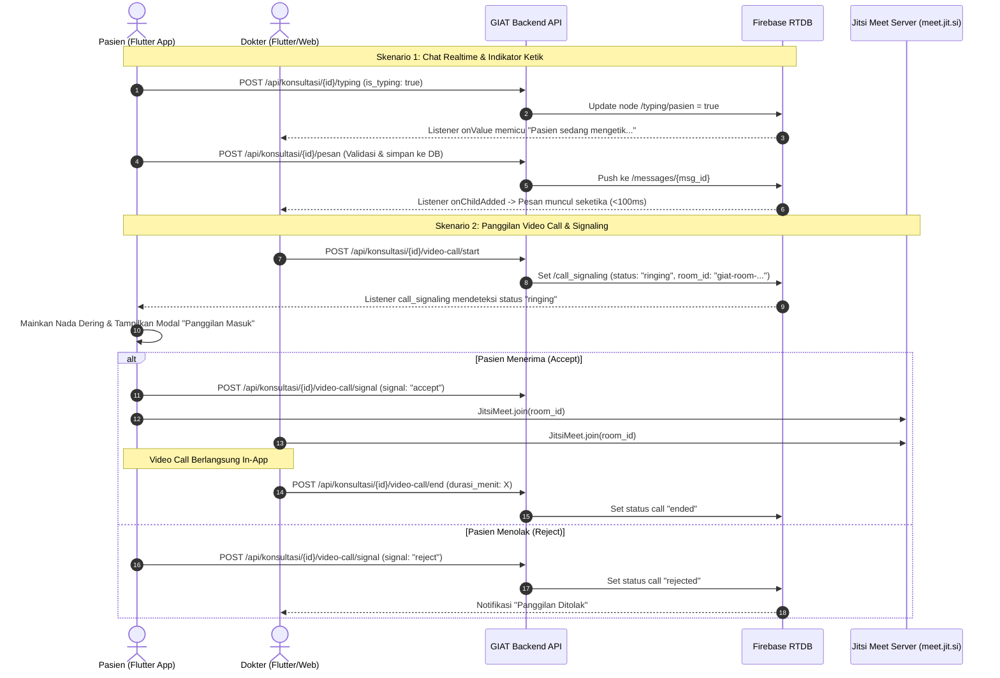

# Rencana Implementasi: Mobile (Flutter) — Chat Realtime & Video Call (GIAT Telemedicine)

Dokumen ini merinci rancangan implementasi teknis di sisi **Aplikasi Mobile (Flutter)** untuk mengintegrasikan fitur **Chat Realtime (Firebase Realtime Database)** dan **Video Call (Jitsi Meet SDK + Firebase Call Signaling)** dengan backend GIAT Laravel API.

---

## 1. Arsitektur Solusi & Alur Kerja



---

## 2. Pilihan Teknologi Mobile

1. **Chat Realtime**:
   * Menggunakan package resmi `firebase_database` (Firebase Realtime Database).
   * **Mekanisme**: Mendengarkan event stream `onChildAdded` pada path `konsultasi/{id}/messages`. Begitu backend Laravel mem-push pesan, data otomatis tersinkronisasi ke aplikasi mobile dalam waktu < 100 ms tanpa polling HTTP.
2. **Video Call In-App**:
   * Menggunakan `jitsi_meet_flutter_sdk`.
   * **100% Gratis Selamanya**: Tidak membutuhkan kartu kredit, tidak ada batasan kuota menit per bulan seperti Agora (yang membatasi 10.000 menit) atau Twilio/Daily.
   * **Native In-App UI**: Menyediakan tampilan kamera, audio, grid view, ganti kamera depan/belakang, dan kontrol end call siap pakai.
3. **Call Signaling (Nada Dering & Panggilan Masuk)**:
   * Menggunakan node `konsultasi/{id}/call_signaling` di Firebase Realtime Database.
   * Nada dering lokal diputar menggunakan `audioplayers`.

---

## 3. Konfigurasi Dependensi (`pubspec.yaml`)

Tambahkan package berikut pada file `pubspec.yaml`:

```yaml
dependencies:
  flutter:
    sdk: flutter

  # 1. HTTP Client & Penyimpanan Token
  http: ^1.2.1
  flutter_secure_storage: ^9.0.0
  intl: ^0.19.0

  # 2. Firebase Realtime Database
  firebase_core: ^3.1.0
  firebase_database: ^11.0.0

  # 3. Video Call SDK (Jitsi Meet Resmi & Bebas Biaya)
  jitsi_meet_flutter_sdk: ^0.5.2

  # 4. Audio Nada Dering Panggilan Masuk
  audioplayers: ^6.0.0

  # 5. Permission Izin Kamera & Mikrofon
  permission_handler: ^11.3.1
```

Jalankan perintah instalasi:
```bash
flutter pub get
```

---

## 4. Konfigurasi Izin Native (Android & iOS)

### A. Android Setup

1. **`android/app/build.gradle`**:
   Pastikan `minSdkVersion` diatur minimal **23**:
   ```groovy
   android {
       defaultConfig {
           minSdkVersion 23 // Wajib untuk Jitsi SDK
           targetSdkVersion 34
           multiDexEnabled true
       }
   }
   ```

2. **`android/app/src/main/AndroidManifest.xml`**:
   Tambahkan izin hardware di dalam tag `<manifest>`:
   ```xml
   <uses-permission android:name="android.permission.INTERNET" />
   <uses-permission android:name="android.permission.CAMERA" />
   <uses-permission android:name="android.permission.RECORD_AUDIO" />
   <uses-permission android:name="android.permission.MODIFY_AUDIO_SETTINGS" />
   <uses-permission android:name="android.permission.ACCESS_NETWORK_STATE" />
   <uses-permission android:name="android.permission.BLUETOOTH" />
   <uses-permission android:name="android.permission.WAKE_LOCK" />
   ```

### B. iOS Setup (`ios/Runner/Info.plist`)

Tambahkan entri deskripsi izin privasi kamera dan mikrofon:
```xml
<key>NSCameraUsageDescription</key>
<string>GIAT memerlukan akses kamera untuk melakukan konsultasi video call bersama dokter.</string>
<key>NSMicrophoneUsageDescription</key>
<string>GIAT memerlukan akses mikrofon untuk komunikasi suara saat konsultasi video call.</string>
```

---

## 5. Struktur Berkas Rekomendasi (Clean Architecture)

```text
lib/
├── core/
│   ├── constants/
│   │   └── api_constants.dart             # Base URL API Laravel
│   └── utils/
│       └── ringtone_player.dart           # Pemutar nada dering panggilan
├── features/
│   └── konsultasi/
│       ├── models/
│       │   ├── chat_message_model.dart    # Model pesan chat
│       │   └── call_signal_model.dart     # Model sinyal video call
│       ├── services/
│       │   ├── consultation_api_service.dart     # Panggilan HTTP ke Laravel
│       │   ├── firebase_realtime_service.dart    # Listener Stream Firebase RTDB
│       │   └── jitsi_video_service.dart          # Controller Jitsi Meet SDK
│       ├── providers/ / controllers/             # State Management (Provider/Bloc/Riverpod)
│       │   ├── chat_controller.dart
│       │   └── call_signaling_controller.dart
│       └── views/
│           ├── chat_room_page.dart               # Tampilan ruang chat konsultasi
│           └── widgets/
│               ├── chat_bubble_widget.dart
│               ├── typing_indicator_widget.dart
│               └── incoming_call_dialog.dart     # Modal panggilan video masuk
```

---

## 6. Implementasi Kode Lengkap (Dart)

### A. Model Data Pesan (`chat_message_model.dart`)

```dart
class ChatMessage {
  final String id;
  final String idSender;
  final String senderName;
  final String senderRole;
  final String pesan;
  final String tipe;
  final String? attachmentUrl;
  final String createdAt;

  ChatMessage({
    required this.id,
    required this.idSender,
    required this.senderName,
    required this.senderRole,
    required this.pesan,
    this.tipe = 'text',
    this.attachmentUrl,
    required this.createdAt,
  });

  factory ChatMessage.fromMap(Map<dynamic, dynamic> map) {
    return ChatMessage(
      id: map['id']?.toString() ?? '',
      idSender: map['id_sender']?.toString() ?? '',
      senderName: map['sender_name']?.toString() ?? 'Pengguna',
      senderRole: map['sender_role']?.toString() ?? 'pasien',
      pesan: map['pesan']?.toString() ?? '',
      tipe: map['tipe']?.toString() ?? 'text',
      attachmentUrl: map['attachment_url']?.toString(),
      createdAt: map['created_at']?.toString() ?? '',
    );
  }

  Map<String, dynamic> toMap() {
    return {
      'id': id,
      'id_sender': idSender,
      'sender_name': senderName,
      'sender_role': senderRole,
      'pesan': pesan,
      'tipe': tipe,
      'attachment_url': attachmentUrl,
      'created_at': createdAt,
    };
  }
}
```

---

### B. Layanan Firebase Realtime (`firebase_realtime_service.dart`)

```dart
import 'dart:async';
import 'package:firebase_database/firebase_database.dart';
import '../models/chat_message_model.dart';

class FirebaseRealtimeService {
  final FirebaseDatabase _db = FirebaseDatabase.instance;

  /// 1. Mendengarkan pesan baru secara realtime (< 100ms)
  Stream<ChatMessage> listenMessages(String consultationId) {
    final ref = _db.ref('konsultasi/$consultationId/messages');
    return ref.onChildAdded.map((event) {
      final data = event.snapshot.value as Map<dynamic, dynamic>;
      return ChatMessage.fromMap(data);
    });
  }

  /// 2. Mendengarkan status lawan bicara sedang mengetik
  Stream<bool> listenTyping(String consultationId, String partnerRole) {
    // partnerRole: 'dokter' jika pengguna adalah pasien, atau 'pasien' jika pengguna dokter
    final ref = _db.ref('konsultasi/$consultationId/typing/$partnerRole');
    return ref.onValue.map((event) {
      final val = event.snapshot.value;
      if (val is bool) return val;
      return false;
    });
  }

  /// 3. Mendengarkan sinyal panggilan video masuk
  Stream<Map<dynamic, dynamic>?> listenCallSignaling(String consultationId) {
    final ref = _db.ref('konsultasi/$consultationId/call_signaling');
    return ref.onValue.map((event) {
      if (event.snapshot.value == null) return null;
      return event.snapshot.value as Map<dynamic, dynamic>;
    });
  }
}
```

---

### C. Layanan API Backend Laravel (`consultation_api_service.dart`)

```dart
import 'dart:convert';
import 'package:http/http.dart' as http;

class ConsultationApiService {
  final String baseUrl;
  final String authToken;

  ConsultationApiService({required this.baseUrl, required this.authToken});

  Map<String, String> get _headers => {
        'Accept': 'application/json',
        'Content-Type': 'application/json',
        'Authorization': 'Bearer $authToken',
      };

  /// Kirim pesan chat (Disimpan di database backend & dipush ke Firebase)
  Future<bool> sendMessage(String consultationId, String text, {String tipe = 'text'}) async {
    final response = await http.post(
      Uri.parse('$baseUrl/konsultasi/$consultationId/pesan'),
      headers: _headers,
      body: jsonEncode({
        'pesan': text,
        'tipe': tipe,
      }),
    );
    return response.statusCode == 201;
  }

  /// Update indikator sedang mengetik
  Future<void> sendTypingStatus(String consultationId, bool isTyping) async {
    await http.post(
      Uri.parse('$baseUrl/konsultasi/$consultationId/typing'),
      headers: _headers,
      body: jsonEncode({'is_typing': isTyping}),
    );
  }

  /// Mulai Panggilan Video (Start Video Call)
  Future<Map<String, dynamic>?> startVideoCall(String consultationId) async {
    final response = await http.post(
      Uri.parse('$baseUrl/konsultasi/$consultationId/video-call/start'),
      headers: _headers,
      body: jsonEncode({'notify_chat': true}),
    );
    if (response.statusCode == 201) {
      final json = jsonDecode(response.body);
      return json['data']; // Berisi room_id & video_call_url
    }
    return null;
  }

  /// Beri respon sinyal panggilan (accept / reject / busy)
  Future<void> respondCallSignal(String consultationId, String signal) async {
    await http.post(
      Uri.parse('$baseUrl/konsultasi/$consultationId/video-call/signal'),
      headers: _headers,
      body: jsonEncode({'signal': signal}),
    );
  }

  /// Akhiri panggilan video dan simpan durasi
  Future<void> endVideoCall(String consultationId, int durationMinutes) async {
    await http.post(
      Uri.parse('$baseUrl/konsultasi/$consultationId/video-call/end'),
      headers: _headers,
      body: jsonEncode({'durasi_menit': durationMinutes}),
    );
  }
}
```

---

### D. Layanan Video Call Jitsi (`jitsi_video_service.dart`)

```dart
import 'package:jitsi_meet_flutter_sdk/jitsi_meet_flutter_sdk.dart';

class JitsiVideoService {
  final _jitsiMeet = JitsiMeet();

  Future<void> joinRoom({
    required String roomId,
    required String userName,
    required String userEmail,
    Function()? onTerminated,
  }) async {
    var options = JitsiMeetConferenceOptions(
      serverURL: "https://meet.jit.si",
      room: roomId,
      configOverrides: {
        "startWithAudioMuted": false,
        "startWithVideoMuted": false,
        "subject": "Konsultasi Telemedisin GIAT",
      },
      featureFlags: {
        "welcomepage.enabled": false,
        "prejoinpage.enabled": false, // Langsung masuk tanpa konfirmasi preview
      },
      userInfo: JitsiMeetUserInfo(
        displayName: userName,
        email: userEmail,
      ),
    );

    var listener = JitsiMeetEventListener(
      conferenceTerminated: (url, error) {
        if (onTerminated != null) {
          onTerminated();
        }
      },
    );

    await _jitsiMeet.join(options, listener);
  }

  void hangUp() {
    _jitsiMeet.hangUp();
  }
}
```

---

### E. Integrasi Halaman Chat & Panggilan Masuk (`chat_room_page.dart`)

```dart
import 'dart:async';
import 'package:flutter/material.dart';
import 'package:audioplayers/audioplayers.dart';
import '../models/chat_message_model.dart';
import '../services/consultation_api_service.dart';
import '../services/firebase_realtime_service.dart';
import '../services/jitsi_video_service.dart';

class ChatRoomPage extends StatefulWidget {
  final String consultationId;
  final String currentUserId;
  final String currentUserName;
  final String currentUserRole; // 'pasien' atau 'dokter'

  const ChatRoomPage({
    super.key,
    required this.consultationId,
    required this.currentUserId,
    required this.currentUserName,
    required this.currentUserRole,
  });

  @override
  State<ChatRoomPage> createState() => _ChatRoomPageState();
}

class _ChatRoomPageState extends State<ChatRoomPage> {
  final List<ChatMessage> _messages = [];
  final TextEditingController _textController = TextEditingController();
  final ScrollController _scrollController = ScrollController();
  final AudioPlayer _ringtonePlayer = AudioPlayer();

  late ConsultationApiService _apiService;
  late FirebaseRealtimeService _firebaseService;
  late JitsiVideoService _jitsiService;

  StreamSubscription? _msgSub;
  StreamSubscription? _typingSub;
  StreamSubscription? _callSub;

  Timer? _typingDebounce;
  bool _isPartnerTyping = false;
  DateTime? _callStartTime;

  @override
  void initState() {
    super.initState();
    _apiService = ConsultationApiService(
      baseUrl: 'http://10.0.2.2:8000/api', // Sesuaikan URL API Anda
      authToken: 'TOKEN_PENGGUNA_DARI_LOGIN',
    );
    _firebaseService = FirebaseRealtimeService();
    _jitsiService = JitsiVideoService();

    _setupListeners();
  }

  void _setupListeners() {
    // 1. Listen pesan baru masuk
    _msgSub = _firebaseService.listenMessages(widget.consultationId).listen((msg) {
      setState(() {
        _messages.add(msg);
      });
      _scrollToBottom();
    });

    // 2. Listen lawan bicara mengetik
    final partnerRole = widget.currentUserRole == 'pasien' ? 'dokter' : 'pasien';
    _typingSub = _firebaseService.listenTyping(widget.consultationId, partnerRole).listen((isTyping) {
      setState(() {
        _isPartnerTyping = isTyping;
      });
    });

    // 3. Listen sinyal panggilan masuk (Ringing)
    _callSub = _firebaseService.listenCallSignaling(widget.consultationId).listen((signal) {
      if (signal == null) return;

      final status = signal['status'];
      final callerId = signal['caller_id'];
      final roomId = signal['room_id'];
      final callerName = signal['caller_name'] ?? 'Lawan Bicara';

      if (status == 'ringing' && callerId != widget.currentUserId) {
        _showIncomingCallModal(callerName, roomId);
      } else if (status == 'ended' || status == 'rejected') {
        _ringtonePlayer.stop();
        if (Navigator.canPop(context)) Navigator.pop(context);
      }
    });
  }

  void _scrollToBottom() {
    WidgetsBinding.instance.addPostFrameCallback((_) {
      if (_scrollController.hasClients) {
        _scrollController.animateTo(
          _scrollController.position.maxScrollExtent,
          duration: const Duration(milliseconds: 300),
          curve: Curves.easeOut,
        );
      }
    });
  }

  void _onTextChanged(String text) {
    if (_typingDebounce?.isActive ?? false) _typingDebounce!.cancel();

    _apiService.sendTypingStatus(widget.consultationId, true);

    _typingDebounce = Timer(const Duration(seconds: 2), () {
      _apiService.sendTypingStatus(widget.consultationId, false);
    });
  }

  void _sendMessage() {
    final text = _textController.text.trim();
    if (text.isEmpty) return;

    _textController.clear();
    _apiService.sendTypingStatus(widget.consultationId, false);
    _apiService.sendMessage(widget.consultationId, text);
  }

  Future<void> _startOutgoingCall() async {
    final callData = await _apiService.startVideoCall(widget.consultationId);
    if (callData != null) {
      _callStartTime = DateTime.now();
      _jitsiService.joinRoom(
        roomId: callData['room_id'],
        userName: widget.currentUserName,
        userEmail: '${widget.currentUserId}@giat.id',
        onTerminated: _handleCallEnded,
      );
    }
  }

  void _showIncomingCallModal(String callerName, String roomId) {
    _ringtonePlayer.play(AssetSource('sounds/phone_ringing.mp3'));

    showDialog(
      context: context,
      barrierDismissible: false,
      builder: (ctx) => AlertDialog(
        title: const Text('Panggilan Video Masuk'),
        content: Text('$callerName sedang memanggil Anda...'),
        actions: [
          TextButton(
            onPressed: () async {
              _ringtonePlayer.stop();
              Navigator.pop(ctx);
              await _apiService.respondCallSignal(widget.consultationId, 'reject');
            },
            child: const Text('Tolak', style: TextStyle(color: Colors.red)),
          ),
          ElevatedButton(
            onPressed: () async {
              _ringtonePlayer.stop();
              Navigator.pop(ctx);
              await _apiService.respondCallSignal(widget.consultationId, 'accept');

              _callStartTime = DateTime.now();
              _jitsiService.joinRoom(
                roomId: roomId,
                userName: widget.currentUserName,
                userEmail: '${widget.currentUserId}@giat.id',
                onTerminated: _handleCallEnded,
              );
            },
            style: ElevatedButton.styleFrom(backgroundColor: Colors.green),
            child: const Text('Terima', style: TextStyle(color: Colors.white)),
          ),
        ],
      ),
    );
  }

  void _handleCallEnded() {
    int durationMinutes = 1;
    if (_callStartTime != null) {
      durationMinutes = DateTime.now().difference(_callStartTime!).inMinutes;
      if (durationMinutes < 1) durationMinutes = 1;
    }
    _apiService.endVideoCall(widget.consultationId, durationMinutes);
  }

  @override
  void dispose() {
    _msgSub?.cancel();
    _typingSub?.cancel();
    _callSub?.cancel();
    _typingDebounce?.cancel();
    _ringtonePlayer.dispose();
    _scrollController.dispose();
    _textController.dispose();
    super.dispose();
  }

  @override
  Widget build(BuildContext context) {
    return Scaffold(
      appBar: AppBar(
        title: const Text('Konsultasi Dokter'),
        actions: [
          IconButton(
            icon: const Icon(Icons.videocam, color: Colors.blueAccent),
            tooltip: 'Mulai Video Call',
            onPressed: _startOutgoingCall,
          ),
        ],
      ),
      body: Column(
        children: [
          Expanded(
            child: ListView.builder(
              controller: _scrollController,
              itemCount: _messages.length,
              itemBuilder: (context, index) {
                final msg = _messages[index];
                final isMe = msg.idSender == widget.currentUserId;
                return Align(
                  alignment: isMe ? Alignment.centerRight : Alignment.centerLeft,
                  child: Container(
                    margin: const EdgeInsets.symmetric(horizontal: 12, vertical: 4),
                    padding: const EdgeInsets.all(12),
                    decoration: BoxDecoration(
                      color: isMe ? Colors.blue[600] : Colors.grey[200],
                      borderRadius: BorderRadius.circular(12),
                    ),
                    child: Text(
                      msg.pesan,
                      style: TextStyle(color: isMe ? Colors.white : Colors.black87),
                    ),
                  ),
                );
              },
            ),
          ),
          if (_isPartnerTyping)
            const Padding(
              padding: EdgeInsets.symmetric(horizontal: 16, vertical: 4),
              child: Align(
                alignment: Alignment.centerLeft,
                child: Text('Sedang mengetik...', style: TextStyle(fontSize: 12, fontStyle: FontStyle.italic, color: Colors.grey)),
              ),
            ),
          Padding(
            padding: const EdgeInsets.all(8.0),
            child: Row(
              children: [
                Expanded(
                  child: TextField(
                    controller: _textController,
                    onChanged: _onTextChanged,
                    decoration: const InputDecoration(
                      hintText: 'Ketik pesan...',
                      border: OutlineInputBorder(),
                    ),
                  ),
                ),
                IconButton(
                  icon: const Icon(Icons.send, color: Colors.blue),
                  onPressed: _sendMessage,
                ),
              ],
            ),
          ),
        ],
      ),
    );
  }
}
```

---

## 7. Tahapan Eksekusi untuk Tim Mobile (Checklist)

- [ ] **Fase 1: Setup Dependensi & Permission**
  - Tambahkan `firebase_database`, `jitsi_meet_flutter_sdk`, `audioplayers`, dan `permission_handler` di `pubspec.yaml`.
  - Atur `minSdkVersion 23` di `android/app/build.gradle`.
  - Pasang file `google-services.json` (Android) & `GoogleService-Info.plist` (iOS) dari Firebase Console.
- [ ] **Fase 2: Implementasi Layanan (Services)**
  - Tulis model data `ChatMessage`.
  - Tulis `FirebaseRealtimeService` untuk stream `messages`, `typing`, dan `call_signaling`.
  - Tulis `ConsultationApiService` untuk request API ke backend Laravel.
  - Tulis `JitsiVideoService` untuk membuka panggilan video in-app.
- [ ] **Fase 3: Pembuatan UI Ruang Chat**
  - Tampilkan daftar pesan dengan bubble chat (beda warna pasien vs dokter).
  - Tampilkan banner/animasi *"Dokter sedang mengetik..."* di atas input pesan saat `listenTyping` bernilai `true`.
  - Tambahkan tombol "Mulai Video Call" di header chat.
- [ ] **Fase 4: Integrasi Call Signaling & Ringtone**
  - Tambahkan aset suara `assets/sounds/phone_ringing.mp3` di `pubspec.yaml`.
  - Tambahkan listener sinyal panggilan masuk saat pengguna berada di halaman chat atau dashboard.
  - Buat dialog/modal panggilan masuk dengan tombol **Terima (Hijau)** dan **Tolak (Merah)**.
- [ ] **Fase 5: Pengujian Antar Perangkat**
  - Jalankan 1 instans aplikasi sebagai **Pasien** (misal di Emulator Android).
  - Jalankan 1 instans aplikasi / Web / Postman sebagai **Dokter**.
  - Uji chat realtime, indikator ketik, serta panggilan video call bolak-balik.
